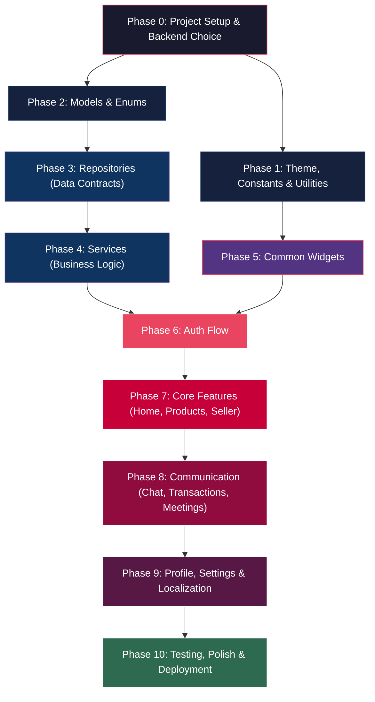
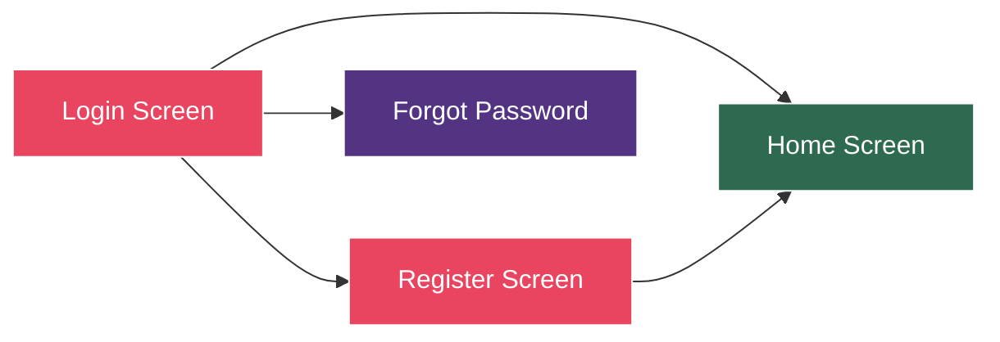
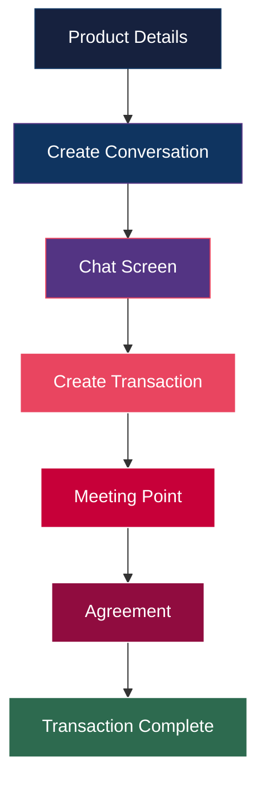
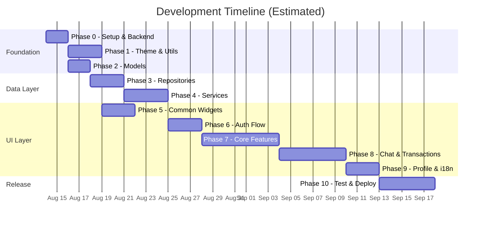

# 🗺️ Buy N Sell IIT BHU — Development Workflow

> Task precedence and phased roadmap for completing the app end-to-end.

## Dependency Graph (High-Level)

---

## Phase 0: Project Setup & Backend Choice ⚙️
> **Prerequisite for everything. Do this first.**

| # | Task | Files | Depends On |
|---|------|-------|------------|
| 0.1 | **Choose backend** (Firebase / Supabase / custom REST API) | — | — |
| 0.2 | Add backend dependencies to `pubspec.yaml` | [`pubspec.yaml`](file:///c:/Users/Asus/OneDrive/Desktop/Flutter/buynsell/pubspec.yaml) | 0.1 |
| 0.3 | Add state management package (Provider / Riverpod / Bloc / GetX) | [`pubspec.yaml`](file:///c:/Users/Asus/OneDrive/Desktop/Flutter/buynsell/pubspec.yaml) | 0.1 |
| 0.4 | Configure Firebase / Supabase project (if applicable) | `android/`, `ios/`, `web/` | 0.1 |
| 0.5 | Add other common packages (`image_picker`, `cached_network_image`, `intl`, `shared_preferences`, `http`/`dio`) | [`pubspec.yaml`](file:///c:/Users/Asus/OneDrive/Desktop/Flutter/buynsell/pubspec.yaml) | 0.1 |

> [!IMPORTANT]
> **Decision needed**: Which backend and state management approach? This determines how repositories and services are implemented.
>
> **Recommended stack**: Firebase (Auth + Firestore + Storage) + Riverpod/Provider

---

## Phase 1: Theme, Constants & Utilities 🎨
> **No dependencies on backend. Can be done in parallel with Phase 2.**

| # | Task | Files | Depends On |
|---|------|-------|------------|
| 1.1 | Finalize color palette & typography | [`app_colors.dart`](file:///c:/Users/Asus/OneDrive/Desktop/Flutter/buynsell/lib/util/theme/app_colors.dart), [`app_text_styles.dart`](file:///c:/Users/Asus/OneDrive/Desktop/Flutter/buynsell/lib/util/theme/app_text_styles.dart) | — |
| 1.2 | Complete light & dark themes | [`app_theme.dart`](file:///c:/Users/Asus/OneDrive/Desktop/Flutter/buynsell/lib/util/theme/app_theme.dart) | 1.1 |
| 1.3 | Fill in API endpoint URLs | [`api_constants.dart`](file:///c:/Users/Asus/OneDrive/Desktop/Flutter/buynsell/lib/util/constants/api_constants.dart) | 0.1 |
| 1.4 | Complete app & asset constants | [`app_constants.dart`](file:///c:/Users/Asus/OneDrive/Desktop/Flutter/buynsell/lib/util/constants/app_constants.dart), [`asset_constants.dart`](file:///c:/Users/Asus/OneDrive/Desktop/Flutter/buynsell/lib/util/constants/asset_constants.dart) | — |
| 1.5 | Implement validation helpers | [`validation_helper.dart`](file:///c:/Users/Asus/OneDrive/Desktop/Flutter/buynsell/lib/util/helpers/validation_helper.dart) | — |
| 1.6 | Implement formatters (currency ₹, dates) | [`currency_formatter.dart`](file:///c:/Users/Asus/OneDrive/Desktop/Flutter/buynsell/lib/util/formatters/currency_formatter.dart), [`date_formatter.dart`](file:///c:/Users/Asus/OneDrive/Desktop/Flutter/buynsell/lib/util/formatters/date_formatter.dart) | 0.5 |
| 1.7 | Implement snackbar & navigation helpers | [`snackbar_helper.dart`](file:///c:/Users/Asus/OneDrive/Desktop/Flutter/buynsell/lib/util/helpers/snackbar_helper.dart), [`navigation_helper.dart`](file:///c:/Users/Asus/OneDrive/Desktop/Flutter/buynsell/lib/util/helpers/navigation_helper.dart) | — |
| 1.8 | Implement device utilities | [`device_utils.dart`](file:///c:/Users/Asus/OneDrive/Desktop/Flutter/buynsell/lib/util/device/device_utils.dart) | — |

---

## Phase 2: Models & Enums 📦
> **No backend dependency. Can be done in parallel with Phase 1.**

| # | Task | Files | Depends On |
|---|------|-------|------------|
| 2.1 | Finalize `UserModel` fields & serialization | [`user_model.dart`](file:///c:/Users/Asus/OneDrive/Desktop/Flutter/buynsell/lib/models/user_model.dart) | 0.1 |
| 2.2 | Finalize `ProductModel` with condition & status enums | [`product_model.dart`](file:///c:/Users/Asus/OneDrive/Desktop/Flutter/buynsell/lib/models/product_model.dart) | 0.1 |
| 2.3 | Finalize `CategoryModel` | [`category_model.dart`](file:///c:/Users/Asus/OneDrive/Desktop/Flutter/buynsell/lib/models/category_model.dart) | — |
| 2.4 | Finalize `ConversationModel` & `MessageModel` | [`conversation_model.dart`](file:///c:/Users/Asus/OneDrive/Desktop/Flutter/buynsell/lib/models/conversation_model.dart), [`message_model.dart`](file:///c:/Users/Asus/OneDrive/Desktop/Flutter/buynsell/lib/models/message_model.dart) | 0.1 |
| 2.5 | Finalize `TransactionModel` | [`transaction_model.dart`](file:///c:/Users/Asus/OneDrive/Desktop/Flutter/buynsell/lib/models/transaction_model.dart) | 0.1 |
| 2.6 | Finalize `MeetingModel` | [`meeting_model.dart`](file:///c:/Users/Asus/OneDrive/Desktop/Flutter/buynsell/lib/models/meeting_model.dart) | 0.1 |

> [!TIP]
> If using Firebase Firestore, align field names with your Firestore document structure. If using a REST API, align with the JSON response schema.

---

## Phase 3: Repositories (Data Contracts) 📋
> **Depends on: Phase 2 (models must be finalized)**

| # | Task | Files | Depends On |
|---|------|-------|------------|
| 3.1 | Implement `AuthRepository` (concrete, Firebase/API) | [`auth_repository.dart`](file:///c:/Users/Asus/OneDrive/Desktop/Flutter/buynsell/lib/repositories/auth_repository.dart) | 2.1, 0.4 |
| 3.2 | Implement `ProductRepository` | [`product_repository.dart`](file:///c:/Users/Asus/OneDrive/Desktop/Flutter/buynsell/lib/repositories/product_repository.dart) | 2.2, 2.3, 0.4 |
| 3.3 | Implement `ChatRepository` | [`chat_repository.dart`](file:///c:/Users/Asus/OneDrive/Desktop/Flutter/buynsell/lib/repositories/chat_repository.dart) | 2.4, 0.4 |
| 3.4 | Implement `TransactionRepository` | [`transaction_repository.dart`](file:///c:/Users/Asus/OneDrive/Desktop/Flutter/buynsell/lib/repositories/transaction_repository.dart) | 2.5, 2.6, 0.4 |

---

## Phase 4: Services (Business Logic) ⚡
> **Depends on: Phase 3 (repositories must have concrete implementations)**

| # | Task | Files | Depends On |
|---|------|-------|------------|
| 4.1 | Implement `AuthService` | [`auth_service.dart`](file:///c:/Users/Asus/OneDrive/Desktop/Flutter/buynsell/lib/services/auth_service.dart) | 3.1 |
| 4.2 | Implement `ProductService` | [`product_service.dart`](file:///c:/Users/Asus/OneDrive/Desktop/Flutter/buynsell/lib/services/product_service.dart) | 3.2 |
| 4.3 | Implement `ChatService` | [`chat_service.dart`](file:///c:/Users/Asus/OneDrive/Desktop/Flutter/buynsell/lib/services/chat_service.dart) | 3.3 |
| 4.4 | Implement `TransactionService` | [`transaction_service.dart`](file:///c:/Users/Asus/OneDrive/Desktop/Flutter/buynsell/lib/services/transaction_service.dart) | 3.4 |
| 4.5 | Implement `StorageService` (image upload) | [`storage_service.dart`](file:///c:/Users/Asus/OneDrive/Desktop/Flutter/buynsell/lib/services/storage_service.dart) | 0.4 |
| 4.6 | Implement `NotificationService` | [`notification_service.dart`](file:///c:/Users/Asus/OneDrive/Desktop/Flutter/buynsell/lib/services/notification_service.dart) | 0.4 |
| 4.7 | Implement `ApiClient` / `LocalStorage` | [`api_client.dart`](file:///c:/Users/Asus/OneDrive/Desktop/Flutter/buynsell/lib/common/data/api_client.dart), [`local_storage.dart`](file:///c:/Users/Asus/OneDrive/Desktop/Flutter/buynsell/lib/common/data/local_storage.dart) | 0.5 |

---

## Phase 5: Common Widgets 🧩
> **Depends on: Phase 1 (theme system). Can be done in parallel with Phases 3-4.**

| # | Task | Files | Depends On |
|---|------|-------|------------|
| 5.1 | Build `CustomButton` (loading states, variants) | [`custom_button.dart`](file:///c:/Users/Asus/OneDrive/Desktop/Flutter/buynsell/lib/common/widgets/custom_button.dart) | 1.1, 1.2 |
| 5.2 | Build `CustomTextField` (validation, icons) | [`custom_text_field.dart`](file:///c:/Users/Asus/OneDrive/Desktop/Flutter/buynsell/lib/common/widgets/custom_text_field.dart) | 1.1, 1.2 |
| 5.3 | Build `ProductCard` (thumbnail, price, badge) | [`product_card.dart`](file:///c:/Users/Asus/OneDrive/Desktop/Flutter/buynsell/lib/common/widgets/product_card.dart) | 1.1, 2.2 |
| 5.4 | Build `LoadingWidget` / shimmer placeholders | [`loading_widget.dart`](file:///c:/Users/Asus/OneDrive/Desktop/Flutter/buynsell/lib/common/widgets/loading_widget.dart) | 1.1 |
| 5.5 | Build `EmptyStateWidget` | [`empty_state_widget.dart`](file:///c:/Users/Asus/OneDrive/Desktop/Flutter/buynsell/lib/common/widgets/empty_state_widget.dart) | 1.1 |
| 5.6 | Build `ImagePickerWidget` | [`image_picker_widget.dart`](file:///c:/Users/Asus/OneDrive/Desktop/Flutter/buynsell/lib/common/widgets/image_picker_widget.dart) | 0.5 |

---

## Phase 6: Auth Flow 🔐
> **Depends on: Phases 4 & 5. This is the first user-facing feature.**

| # | Task | Files | Depends On |
|---|------|-------|------------|
| 6.1 | Implement `AuthController` (state management) | [`auth_controller.dart`](file:///c:/Users/Asus/OneDrive/Desktop/Flutter/buynsell/lib/common/controllers/auth_controller.dart) | 4.1 |
| 6.2 | Wire up `LoginScreen` with real auth | [`login_screen.dart`](file:///c:/Users/Asus/OneDrive/Desktop/Flutter/buynsell/lib/screens/auth/login_screen.dart) | 6.1, 5.1, 5.2 |
| 6.3 | Wire up `RegisterScreen` with real auth | [`register_screen.dart`](file:///c:/Users/Asus/OneDrive/Desktop/Flutter/buynsell/lib/screens/auth/register_screen.dart) | 6.1, 5.1, 5.2 |
| 6.4 | Set up route guards (redirect if not logged in) | [`app.dart`](file:///c:/Users/Asus/OneDrive/Desktop/Flutter/buynsell/lib/app.dart), [`app_routes.dart`](file:///c:/Users/Asus/OneDrive/Desktop/Flutter/buynsell/lib/routes/app_routes.dart) | 6.1 |

> [!IMPORTANT]
> **Milestone 🎯**: After Phase 6, users can register and log in. Test the full auth flow before proceeding.

---

## Phase 7: Core Features (Home, Products, Seller) 🏠🛍️
> **Depends on: Phase 6 (user must be authenticated)**

| # | Task | Files | Depends On |
|---|------|-------|------------|
| **Home** | | | |
| 7.1 | Wire `HomeScreen` with real product data | [`home_screen.dart`](file:///c:/Users/Asus/OneDrive/Desktop/Flutter/buynsell/lib/screens/home/home_screen.dart) | 4.2, 5.3 |
| 7.2 | Wire `CategoriesScreen` | [`categories_screen.dart`](file:///c:/Users/Asus/OneDrive/Desktop/Flutter/buynsell/lib/screens/home/categories_screen.dart) | 4.2 |
| 7.3 | Implement `ProductController` | [`product_controller.dart`](file:///c:/Users/Asus/OneDrive/Desktop/Flutter/buynsell/lib/common/controllers/product_controller.dart) | 4.2 |
| **Products** | | | |
| 7.4 | Wire `ProductListScreen` with filtering | [`product_list_screen.dart`](file:///c:/Users/Asus/OneDrive/Desktop/Flutter/buynsell/lib/screens/products/product_list_screen.dart) | 7.3, 5.3 |
| 7.5 | Wire `ProductDetailsScreen` | [`product_details_screen.dart`](file:///c:/Users/Asus/OneDrive/Desktop/Flutter/buynsell/lib/screens/products/product_details_screen.dart) | 7.3 |
| 7.6 | Implement `SearchScreen` with debouncing | [`search_screen.dart`](file:///c:/Users/Asus/OneDrive/Desktop/Flutter/buynsell/lib/screens/products/search_screen.dart) | 7.3 |
| 7.7 | Implement `FiltersScreen` | [`filters_screen.dart`](file:///c:/Users/Asus/OneDrive/Desktop/Flutter/buynsell/lib/screens/products/filters_screen.dart) | 7.3 |
| **Seller** | | | |
| 7.8 | Wire `UploadProductScreen` with image picker & storage | [`upload_product_screen.dart`](file:///c:/Users/Asus/OneDrive/Desktop/Flutter/buynsell/lib/screens/seller/upload_product_screen.dart) | 4.2, 4.5, 5.6 |
| 7.9 | Wire `EditProductScreen` | [`edit_product_screen.dart`](file:///c:/Users/Asus/OneDrive/Desktop/Flutter/buynsell/lib/screens/seller/edit_product_screen.dart) | 7.8 |
| 7.10 | Wire `MyProductsScreen` | [`my_products_screen.dart`](file:///c:/Users/Asus/OneDrive/Desktop/Flutter/buynsell/lib/screens/seller/my_products_screen.dart) | 7.3 |
| 7.11 | Wire `SellerDashboardScreen` with stats | [`seller_dashboard_screen.dart`](file:///c:/Users/Asus/OneDrive/Desktop/Flutter/buynsell/lib/screens/seller/seller_dashboard_screen.dart) | 7.10 |
| 7.12 | Wire `SalesScreen` | [`sales_screen.dart`](file:///c:/Users/Asus/OneDrive/Desktop/Flutter/buynsell/lib/screens/seller/sales_screen.dart) | 4.4 |

> [!IMPORTANT]
> **Milestone 🎯**: After Phase 7, users can browse, search, filter, and upload products. This is your **MVP**.

---

## Phase 8: Communication & Transactions 💬💰
> **Depends on: Phase 7 (products must exist to chat about / transact)**

| # | Task | Files | Depends On |
|---|------|-------|------------|
| **Chat** | | | |
| 8.1 | Implement `ChatController` | [`chat_controller.dart`](file:///c:/Users/Asus/OneDrive/Desktop/Flutter/buynsell/lib/common/controllers/chat_controller.dart) | 4.3 |
| 8.2 | Wire `ConversationsScreen` | [`conversations_screen.dart`](file:///c:/Users/Asus/OneDrive/Desktop/Flutter/buynsell/lib/screens/chat/conversations_screen.dart) | 8.1 |
| 8.3 | Wire `ChatScreen` with real-time messaging | [`chat_screen.dart`](file:///c:/Users/Asus/OneDrive/Desktop/Flutter/buynsell/lib/screens/chat/chat_screen.dart) | 8.1 |
| **Transactions** | | | |
| 8.4 | Wire `TransactionScreen` | [`transaction_screen.dart`](file:///c:/Users/Asus/OneDrive/Desktop/Flutter/buynsell/lib/screens/transactions/transaction_screen.dart) | 4.4 |
| 8.5 | Wire `RecentTransactionsScreen` | [`recent_transactions_screen.dart`](file:///c:/Users/Asus/OneDrive/Desktop/Flutter/buynsell/lib/screens/transactions/recent_transactions_screen.dart) | 4.4 |
| 8.6 | Wire `TransactionDetailsScreen` | [`transaction_details_screen.dart`](file:///c:/Users/Asus/OneDrive/Desktop/Flutter/buynsell/lib/screens/transactions/transaction_details_screen.dart) | 8.4 |
| **Buyer** | | | |
| 8.7 | Wire `WishlistScreen` | [`wishlist_screen.dart`](file:///c:/Users/Asus/OneDrive/Desktop/Flutter/buynsell/lib/screens/buyer/wishlist_screen.dart) | 4.2 |
| 8.8 | Wire `PurchasesScreen` | [`purchases_screen.dart`](file:///c:/Users/Asus/OneDrive/Desktop/Flutter/buynsell/lib/screens/buyer/purchases_screen.dart) | 4.4 |
| 8.9 | Wire `PurchaseDetailsScreen` | [`purchase_details_screen.dart`](file:///c:/Users/Asus/OneDrive/Desktop/Flutter/buynsell/lib/screens/buyer/purchase_details_screen.dart) | 8.8 |
| **Meeting** | | | |
| 8.10 | Wire `MeetingPointScreen` (campus map / location) | [`meeting_point_screen.dart`](file:///c:/Users/Asus/OneDrive/Desktop/Flutter/buynsell/lib/screens/meeting/meeting_point_screen.dart) | 8.4 |
| 8.11 | Wire `AgreementScreen` | [`agreement_screen.dart`](file:///c:/Users/Asus/OneDrive/Desktop/Flutter/buynsell/lib/screens/meeting/agreement_screen.dart) | 8.10 |

---

## Phase 9: Profile, Settings & Localization 👤🌐
> **Depends on: Phase 6 (auth), Phase 8 (transaction data for profile stats)**

| # | Task | Files | Depends On |
|---|------|-------|------------|
| 9.1 | Wire `ProfileScreen` with user data & stats | [`profile_screen.dart`](file:///c:/Users/Asus/OneDrive/Desktop/Flutter/buynsell/lib/screens/profile/profile_screen.dart) | 4.1 |
| 9.2 | Wire `SettingsScreen` (theme toggle, logout, etc.) | [`settings_screen.dart`](file:///c:/Users/Asus/OneDrive/Desktop/Flutter/buynsell/lib/screens/profile/settings_screen.dart) | 1.2, 6.1 |
| 9.3 | Complete English translations | [`en.dart`](file:///c:/Users/Asus/OneDrive/Desktop/Flutter/buynsell/lib/localization/translations/en.dart) | — |
| 9.4 | Complete Hindi translations | [`hi.dart`](file:///c:/Users/Asus/OneDrive/Desktop/Flutter/buynsell/lib/localization/translations/hi.dart) | 9.3 |
| 9.5 | Wire `AppLocalizations` into MaterialApp | [`app_localizations.dart`](file:///c:/Users/Asus/OneDrive/Desktop/Flutter/buynsell/lib/localization/app_localizations.dart), [`app.dart`](file:///c:/Users/Asus/OneDrive/Desktop/Flutter/buynsell/lib/app.dart) | 9.3 |
| 9.6 | Set up push notifications | [`notification_service.dart`](file:///c:/Users/Asus/OneDrive/Desktop/Flutter/buynsell/lib/services/notification_service.dart) | 4.6 |

---

## Phase 10: Testing, Polish & Deployment 🚀
> **Final phase. Depends on all previous phases.**

| # | Task | Details | Depends On |
|---|------|---------|------------|
| 10.1 | Unit tests for all models (serialization) | `test/models/` | Phase 2 |
| 10.2 | Unit tests for services | `test/services/` | Phase 4 |
| 10.3 | Widget tests for key screens | `test/screens/` | Phases 6-9 |
| 10.4 | Integration tests (auth → browse → chat → buy) | `integration_test/` | All |
| 10.5 | Add app icon & splash screen | `assets/`, platform configs | — |
| 10.6 | Performance optimization (lazy loading, caching) | Various | All |
| 10.7 | Error handling & edge cases | All services & screens | All |
| 10.8 | Build release APK/IPA | — | All |
| 10.9 | Deploy to Play Store / TestFlight | — | 10.8 |

---

## 🔀 What Can Be Done in Parallel?

| Parallel Track A | Parallel Track B |
|-----------------|-----------------|
| Phase 1 (Theme/Utils) | Phase 2 (Models) |
| Phase 5 (Widgets) | Phases 3-4 (Repos/Services) |
| Phase 9.3-9.4 (Translations) | Phase 8 (Chat/Transactions) |
| Phase 10.1-10.2 (Unit tests) | Phase 9 (Profile/Settings) |

---

## 🎯 Key Milestones

| Milestone | After Phase | What You Can Demo |
|-----------|-------------|-------------------|
| **🔐 Auth Works** | 6 | Users can sign up & log in |
| **🛍️ MVP** | 7 | Browse, search, upload products |
| **💬 Full Loop** | 8 | Chat with sellers, make deals, meet up |
| **🌟 Complete App** | 9 | Localized, polished, profile management |
| **🚀 Launch Ready** | 10 | Tested, optimized, deployed |

> [!TIP]
> **Start with Phase 0** — pick your backend. Everything else flows from that decision. If you want to move fast, Firebase is the easiest to set up and covers auth, database, storage, and push notifications out of the box.
